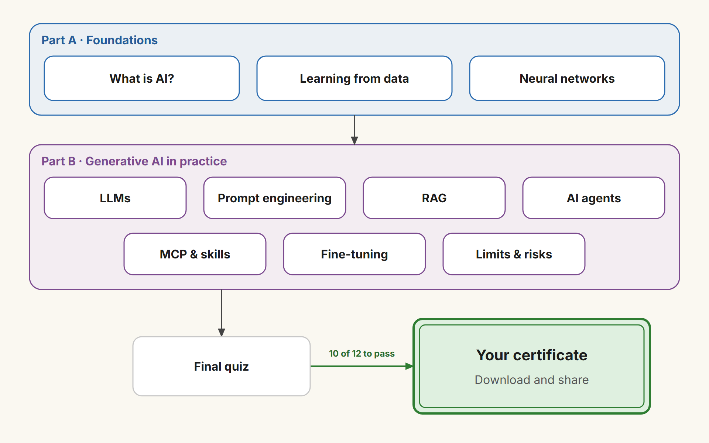
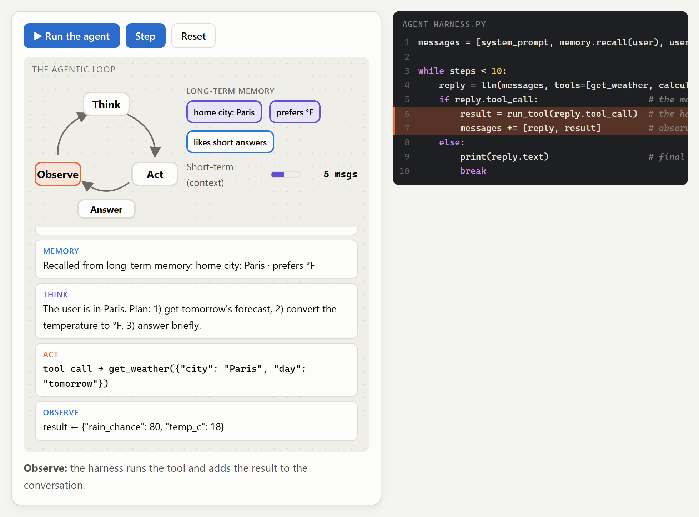
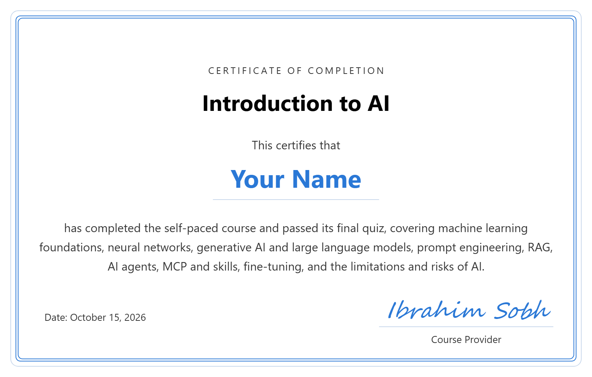

# Introduction to AI

A **self-paced online course, completely free**, that explains how modern AI works: from the basics of machine learning and neural networks to the tools people use every day, including large language models, prompt engineering, RAG, AI agents, MCP and skills, and fine-tuning, plus the risks to watch for. No coding or maths background needed.

<i>Created by <a href="https://www.linkedin.com/in/ibrahim-sobh-phd-8681757/">Ibrahim Sobh, PhD</a></i>

**The certificate is free too.** No sign-up and no fees: pass the final quiz and get a certificate with your name.

## 🚀 Take the course: [ibrahimsobh.github.io/introduction-to-ai](https://ibrahimsobh.github.io/introduction-to-ai/)

✅ Free · no sign-up · runs in your browser

## What you'll learn

- How machines learn from data, from a simple line to neural networks and LLMs.
- How to use generative AI well: prompting, context engineering, RAG, agents, MCP and fine-tuning.
- When AI can be wrong, its main risks, and when a person must check it.

## Main audience

Beginners who want to understand and use modern AI, especially generative AI. No coding or maths background needed.

- **Professionals who use AI tools at work:** managers, analysts, marketers, HR, teachers and consultants who want to know how these tools work, how to prompt well and when to trust the answers.
- **People who make decisions about AI projects:** product owners, team leads, and IT and business managers choosing between prompting, RAG, agents and fine-tuning.
- **Students and career changers** who want a clear first map of the field.
- **Developers new to AI** who want the big picture, with short code sketches, before going deeper.

It isn't aimed at ML engineers or data scientists looking for maths, real training code or hands-on programming exercises.

## Course outline

**Part A · Foundations** (short and high-level, about 20% of the course)

1. **What is AI?**: AI and machine learning, and the three ways machines learn: supervised, unsupervised and reinforcement; classification vs. regression, with object detection in a car's front camera as an example
2. **Learning from Data**: what a model is (a formula with parameters, like `y = a·x + b`), how training finds the best parameters (house prices), why predictions can be wrong, and overfitting vs. underfitting
3. **Neural Networks**: the same idea with many more parameters: layers of neurons with weights, how a network learns by adjusting them (gradient descent), and why training large models needs powerful GPUs

**Part B · Generative AI in practice** (the main focus, about 80%)

4. **Generative AI and LLMs**: what generative AI can create (text, code, images, audio, video), tokens and the context window, pre-training and instruction tuning (base vs. instruction-tuned models), the Transformer, next-token prediction, and which temperature to use for what
5. **Prompt Engineering**: clear instructions and roles, context and examples (few-shot), step-by-step thinking, structured output, and context engineering: choosing everything the model sees
6. **RAG**: why LLMs need external knowledge, embeddings, chunking and vector databases, and the retrieve → augment → generate flow
7. **AI Agents**: agent = LLM + harness (the program that gives the model tools and runs the loop), tool calling, reasoning and planning, the think → act → observe loop (the agent loop, or ReAct), short- and long-term memory, and when to use a chat, RAG or an agent
8. **MCP and Skills**: MCP connects agents to tools and data; Skills teach them how to do a task
9. **Fine-tuning**: what it is, and choosing between prompt engineering, RAG and fine-tuning
10. **Limitations and Risks**: hallucinations, bias, privacy, prompt injection, and when a person must review AI output

## What each lesson gives you

- **A clear explanation** of the main idea, with an everyday analogy, simple diagrams and comparison tables. Where a demo works out numbers (house prices, errors, a neuron, tokens, word chances, similarity), a formula strip above it shows the rule in plain words with the current values.
- **Interactive demos** you drive yourself: train a model, watch a neural network learn, split text into tokens, sample with temperature, build a prompt, run RAG over a handbook, step through an agent loop, and test defences against prompt injection.
- **Short code sketches** beside each demo, with the step being run highlighted, so you see how the idea is used in practice.
- **A quiz in every lesson** (30 questions in total), plus an AI glossary to revise from.

**Example: an AI agent at work.** The agent recalls that the user lives in Paris (long-term memory), plans, then asks for a tool: `get_weather({"city": "Paris", "day": "tomorrow"})`. The harness runs it and the result comes back as an observation, while the loop diagram and the matching line of code light up.

## How long it takes

About 4 hours if you're new to the topic, or about 2 hours if you already work with technology.

| Part | New to the topic | Already work in tech |
|---|---|---|
| Part A: 3 lessons | 3 × 15 min = 45 min | 3 × 8 min = 24 min |
| Part B: 7 lessons | 7 × 25 min = 175 min | 7 × 13 min = 91 min |
| AI glossary review | 10 min | 5 min |
| Final quiz and certificate | 15 min | 10 min |
| **Total** | **245 min ≈ 4 hours** | **130 min ≈ 2 hours** |

## Final quiz and certificate

Finish with the final quiz: 12 questions on the main concepts. Score 10 of 12 or more (80%) to get a certificate with your name, which you can download as an image or save as a PDF and share.

**Here's what your certificate looks like:**

Everything runs in your browser. Nothing you enter, including your name, is sent anywhere.
